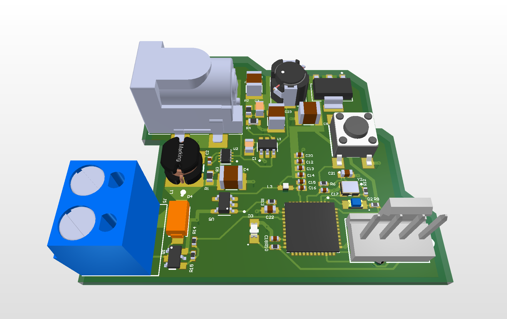
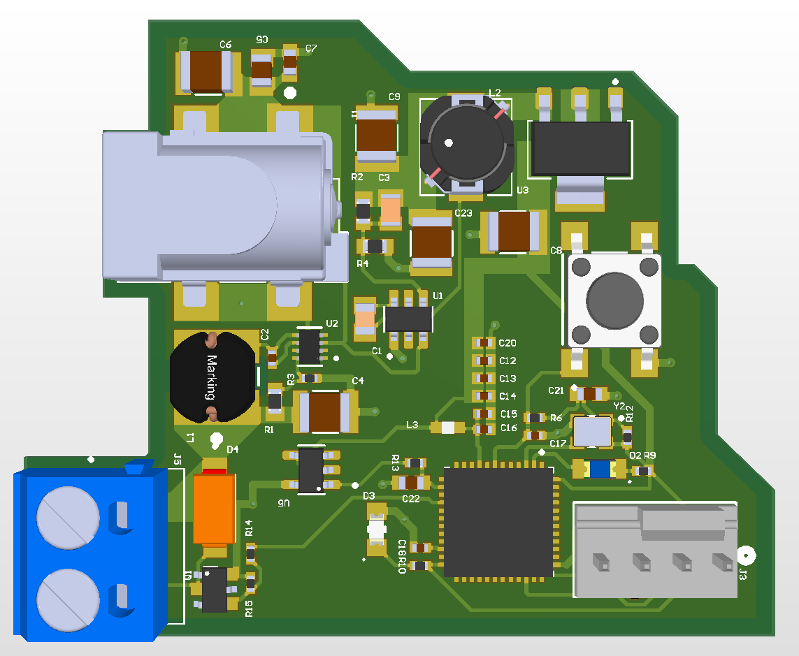
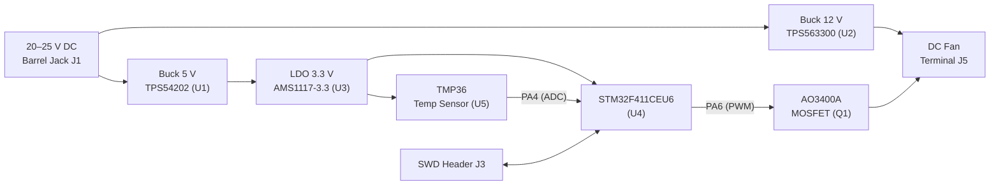
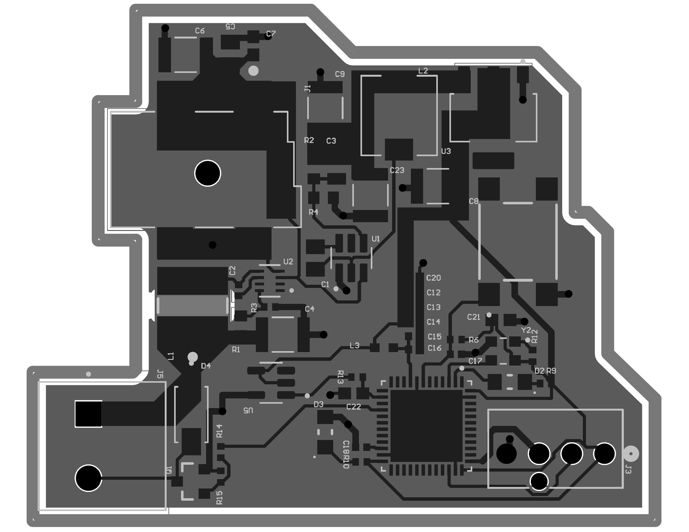

<div align="center">

# 🌡️ Temperature-Controlled DC Fan PCB

**A compact STM32-based controller that measures temperature and drives a 12 V DC fan automatically, powered from a single 20–25 V DC input.**




</div>

---

## Table of Contents

1. [Overview](#overview)
2. [Key Features](#key-features)
3. [System Architecture](#system-architecture)
4. [Hardware Description](#hardware-description)
5. [Pin Assignment](#pin-assignment)
6. [Schematics](#schematics)
7. [PCB Layout](#pcb-layout)
8. [Bill of Materials](#bill-of-materials)
9. [Repository Structure](#repository-structure)
10. [Getting Started](#getting-started)
11. [Roadmap](#roadmap)
12. [Documentation](#documentation)
13. [License](#license)

---

## Overview

This project is a custom-designed printed circuit board that regulates the speed of a DC fan according to the measured ambient temperature. A **TMP36** analog temperature sensor is sampled by the ADC of an **STM32F411CEU6** (ARM Cortex-M4F) microcontroller, which then drives an **N-channel MOSFET** to switch the fan load with PWM.

The board accepts a **20–25 V DC** supply through a barrel jack and generates three regulated rails on-board (**12 V, 5 V, 3.3 V**) using two synchronous buck converters and one linear regulator.

<div align="center">

</div>

## Key Features

| Area | Details |
|---|---|
| **Input power** | 20–25 V DC via barrel jack (`J1`) |
| **On-board rails** | 12 V (fan), 5 V, 3.3 V (logic and sensor) |
| **Microcontroller** | STM32F411CEU6 — Cortex-M4F, 100 MHz, 512 KB Flash |
| **Temperature sensing** | TMP36 analog sensor read through the MCU ADC |
| **Fan driver** | AO3400A logic-level N-MOSFET, low-side switching, SS14 flyback diode |
| **Programming / debug** | 4-pin SWD header (`J3`) |
| **User interface** | Reset push button, blue user LED (`D2`), red power LED (`D3`) |
| **Timing** | 32.768 kHz active oscillator (`Y2`) feeding `PC14` |
| **Fan connector** | 2-position screw terminal (`J5`) |
| **Noise / stability** | 100 nF decoupling on MCU supply, ferrite-bead-filtered `VREF+`, bulk capacitors on every rail |

## System Architecture



The design is organised hierarchically in Altium Designer into four functional sheets under one top-level sheet:

| Sheet | File | Function |
|---|---|---|
| Top level | `Main System.SchDoc` | Interconnects all sub-sheets |
| Power | `Power.SchDoc` | DC jack, 12 V buck, 5 V buck, 3.3 V LDO |
| MCU | `MCU.SchDoc` | STM32F411, reset, SWD, oscillator, LEDs, decoupling |
| Sensor | `Sensor.SchDoc` | TMP36 temperature sensor and filtering |
| Actuator | `Actuator.SchDoc` | MOSFET fan driver and flyback protection |

## Hardware Description

### Power Management

| Stage | IC | Input → Output | Notes |
|---|---|---|---|
| 12 V buck | **TPS563300DRLR** | 20/25 V → 12 V | 3.8–28 V input synchronous buck; 12 µH inductor (`L1`), feedback divider `R1` 140 kΩ / `R3` 10 kΩ (15:1 ratio), 47 µF output cap (`C4`) |
| 5 V buck | **TPS54202DDCR** | 20/25 V → 5 V | 4.5–28 V input, 2 A, EMI-friendly synchronous buck; 15 µH inductor (`L2`), feedback divider `R2` 100 kΩ / `R4` 13.7 kΩ (≈ 4.95 V with the 0.596 V typical reference), 68 pF feed-forward cap (`C3`), 47 µF output cap (`C23`) |
| 3.3 V LDO | **AMS1117-3.3** | 5 V → 3.3 V | Fixed 3.3 V, 1 A, SOT-223, 10 µF caps on input and output |

### Microcontroller

The **STM32F411CEU6** (UFQFPN-48) is the system controller. It provides the 12-bit ADC used to sample the sensor and a hardware timer channel used to generate the fan PWM signal. The design includes a dedicated reset circuit (`S2`, `R6` 10 kΩ pull-up, `C17` 0.1 µF), a 4-pin SWD programming header, a ferrite-bead-filtered analog reference (`L3`, with `C15`/`C16` on `VREF+`), a 1 µF `VCAP_1` capacitor (`C18`), and 100 nF decoupling on the 3.3 V rail (`C12`–`C14`).

### Temperature Sensor

The **TMP36GRTZ** provides an analog output of 10 mV/°C with a 500 mV offset at 0 °C, which is well within the 0–3.3 V ADC input range. It is powered from the 3.3 V rail with a 0.1 µF bypass capacitor (`C21`), its `SHUTDOWN` pin tied to 3.3 V, and a 1 kΩ / 100 nF RC output filter (`R13` + `C22`) before the ADC pin `PA4`.

### Fan Driver

The fan is switched on the low side by an **AO3400A** N-channel MOSFET (30 V, 5.8 A, SOT-23) driven directly from `PA6` through a 150 Ω gate resistor (`R14`), with a 10 kΩ pull-down (`R15`) that keeps the fan off during reset or boot. An **SS14** Schottky diode (`D4`) across the fan terminals clamps the inductive flyback voltage when the fan is switched off.

## Pin Assignment

| MCU Pin | Signal | Function |
|---|---|---|
| `PA4` | `TEMP_ADC` | Analog input from TMP36 |
| `PA6` | `FAN_PWM` | Gate drive for fan MOSFET (timer PWM) |
| `PA13` | `SWDIO` | Serial-wire debug data |
| `PA14` | `SWCLK` | Serial-wire debug clock |
| `NRST` | `NRST` | Reset (push button `S2` + `R6`/`C17` network) |
| `PC13` | `LED` | Blue user LED `D2` via `R9` (active-low, sinks current from 3.3 V) |
| `PC14` | `OSC32_IN` | 32.768 kHz active oscillator `Y2` |
| `VREF+` | `VREF+` | Filtered 3.3 V reference through ferrite bead `L3` |
| — | `D3` (red) | Power-on LED, `R10` 5.1 kΩ from 3.3 V to GND |

## Schematics

| Sheet | Preview |
|---|---|
| System overview | [`schematic-00-system-overview.png`](images/schematic-00-system-overview.png) |
| Power | [`schematic-01-power.png`](images/schematic-01-power.png) |
| MCU | [`schematic-02-mcu.png`](images/schematic-02-mcu.png) |
| Sensor | [`schematic-03-sensor.png`](images/schematic-03-sensor.png) |
| Actuator | [`schematic-04-actuator.png`](images/schematic-04-actuator.png) |

The full vector PDF (schematics, PCB layout and BOM) is available at
[`hardware/schematics/Temperature-Controlled-DC-Fan-PCB_Schematics_BOM.pdf`](hardware/schematics/Temperature-Controlled-DC-Fan-PCB_Schematics_BOM.pdf).

<div align="center">

</div>

## PCB Layout

The board is a compact, irregular-outline PCB with a clear functional partition: power entry and conversion on the left and top, the MCU in the lower right, and the fan terminal at the bottom left.

<div align="center">

</div>

## Bill of Materials

A clean, machine-readable BOM is provided in [`hardware/bom/BOM.csv`](hardware/bom/BOM.csv). The main components are summarised below.

| Ref | Part | Description |
|---|---|---|
| `U1` | TPS54202DDCR | 4.5–28 V, 2 A synchronous buck (5 V) |
| `U2` | TPS563300DRLR | 3.8–28 V, 3 A synchronous buck (12 V) |
| `U3` | AMS1117-3.3 | 3.3 V LDO, 1 A |
| `U4` | STM32F411CEU6 | Cortex-M4F MCU, 512 KB Flash |
| `U5` | TMP36GRTZ-REEL7 | Analog temperature sensor |
| `Q1` | AO3400A | 30 V N-channel MOSFET |
| `D4` | SS14 | 1 A, 40 V Schottky diode |
| `Y2` | ECS-327ATQMV-CN-TR | 32.768 kHz active oscillator |
| `J1` | PJ-002BH-SMT-TR | DC power jack |
| `J3` | 470531000 | 4-pin 2.54 mm SWD header |
| `J5` | OSTTA020161 | 2-position screw terminal |

## Repository Structure

```text
temperature-controlled-fan-pcb/
├── README.md
├── LICENSE
├── .gitignore
├── docs/
│   ├── design-overview.md       # Detailed design description and calculations
│   ├── bring-up-and-testing.md  # Assembly, bring-up and verification plan
│   └── design-review.md         # Design review notes and recommended improvements
├── hardware/
│   ├── schematics/              # PDF schematics, BOM and layout
│   ├── pcb/                     # Altium project / PcbDoc (add source files here)
│   ├── gerber/                  # Fabrication outputs (add here)
│   └── bom/BOM.csv              # Machine-readable BOM
├── firmware/                    # Firmware (planned)
└── images/                      # Renders, schematics and layout images
```

## Getting Started

1. **Review the design** — start with the [schematic PDF](hardware/schematics/Temperature-Controlled-DC-Fan-PCB_Schematics_BOM.pdf) and [`docs/design-overview.md`](docs/design-overview.md).
2. **Order the board** — export Gerber and drill files from the Altium project into `hardware/gerber/` and send them to your preferred fabricator.
3. **Source the parts** — use [`hardware/bom/BOM.csv`](hardware/bom/BOM.csv).
4. **Assemble and test** — follow [`docs/bring-up-and-testing.md`](docs/bring-up-and-testing.md). Always verify each rail before fitting the MCU.
5. **Program** — connect an ST-LINK to `J3` (SWDIO, SWCLK, 3.3 V, GND).

> ⚠️ **Safety:** the board is supplied from 20–25 V DC. Check polarity and voltage before powering it, and verify the 12 V and 3.3 V rails before connecting a fan or flashing firmware.

## Roadmap

- [x] Schematic capture (hierarchical, 4 functional sheets)
- [x] PCB layout and 3D model review
- [x] BOM with manufacturer part numbers
- [ ] Export Gerber / drill / pick-and-place files
- [ ] Fabricate and assemble prototype
- [ ] Firmware: ADC sampling, temperature-to-duty-cycle curve, PWM fan control
- [ ] Add fan tachometer feedback and over-temperature alarm (future revision)

## Documentation

| Document | Description |
|---|---|
| [Design Overview](docs/design-overview.md) | Block-level design, power calculations and component selection |
| [Bring-up & Testing](docs/bring-up-and-testing.md) | Step-by-step validation plan with expected values |
| [Design Review](docs/design-review.md) | Observations and suggested improvements for the next revision |

## License

This project is released under the [MIT License](LICENSE).

---

<div align="center">
Designed with Altium Designer · October 2026
</div>
